| Module Code        | IY455                                   |
| ------------------ | --------------------------------------- |
| Group              | A                                       |
| Module Title       | Information Systems Analysis and Design |
| Assessment Type    | Coursework Stage 1                      |
| Module Tutor Name  | Mustafa Ghashim                         |
| Student ID Number  | P466146                                 |
| Date of Submission | 22/05/2026                              |

☒ *I confirm that this assignment is my own work. Where I have referred to academic
sources, I have provided in-text citations and included the sources in the
final reference list.*

 ☒ *Where I have used AI, I have cited and referenced appropriately.*

---

### **Task 1 - Normalisation**

##### **Unormalised Data Table:**

| Order ID | Passenger | Passenger Name | Cabin | Cruise No | Cruise Name       | Port          | Excursion No. | Excursion      | Qty | Price per excursion | Excursion leader ID | Excursion Leader | Total Cost |
| -------- | --------- | -------------- | ----- | --------- | ----------------- | ------------- | ------------- | -------------- | --- | ------------------- | ------------------- | ---------------- | ---------- |
| O23      | P001      | Weber          | 2345  | 1012      | Baltic Highlights | Copenhagen    | C001          | Little Mermaid | 5   | 200                 | E0001               | Wermter          | 1900       |
|          |           |                |       |           |                   | Oslo          | O002          | Museums        | 2   | 150                 | E0002               | Smith            |            |
|          |           |                |       |           |                   | St Petersburg | P002          | Palaces        | 1   | 300                 | E1008               | Jones            |            |
|          |           |                |       |           |                   | St Petersburg | P003          | Ballet         | 3   | 100                 | E1008               | Jones            |            |
| O32      | P005      | Elshaw         | 3777  | 2121      | Fjords            | Bergen        | B001          | Biking         | 4   | 50                  | E0070               | Malone           | 1450       |
|          |           |                |       |           |                   | Bergen        | B111          | Hiking         | 10  | 75                  | E0070               | Malone           |            |
|          |           |                |       |           |                   | Holden        | H002          | Puffins        | 5   | 100                 | E0101               | Ham              |            |
| O01      | P003      | Brown          | 8124  | 1012      | Baltic Highlights | Oslo          | O002          | Museums        | 3   | 150                 | E0002               | Smith            | 1050       |
|          |           |                |       |           |                   | St Petersburg | P002          | Palaces        | 2   | 300                 | E1008               | Jones            |            |

##### **1st Normal Form**

| PK       |           |                |       |           |                   |            |
| -------- | --------- | -------------- | ----- | --------- | ----------------- | ---------- |
| Order ID | Passenger | Passenger Name | Cabin | Cruise No | Cruise Name       | Total Cost |
| O23      | P001      | Weber          | 2345  | 1012      | Baltic Highlights | 1900       |
| O32      | P005      | Elshaw         | 3777  | 2121      | Fjords            | 1450       |
| O01      | P003      | Brown          | 8124  | 1012      | Baltic Highlights | 1050       |

| Composite PK  | Composite PK  |               |                |     |                     |                     |                  |
| ------------- | ------------- | ------------- | -------------- | --- | ------------------- | ------------------- | ---------------- |
| Order ID (FK) | Excursion No. | Port          | Excursion      | Qty | Price per excursion | Excursion leader ID | Excursion Leader |
| O23           | C001          | Copenhagen    | Little Mermaid | 5   | 200                 | E0001               | Wermter          |
|               | O002          | Oslo          | Museums        | 2   | 150                 | E0002               | Smith            |
|               | P002          | St Petersburg | Palaces        | 1   | 300                 | E1008               | Jones            |
|               | P003          | St Petersburg | Ballet         | 3   | 100                 | E1008               | Jones            |
| O32           | B001          | Bergen        | Biking         | 4   | 50                  | E0070               | Malone           |
|               | B111          | Bergen        | Hiking         | 10  | 75                  | E0070               | Malone           |
|               | H002          | Holden        | Puffins        | 5   | 100                 | E0101               | Ham              |
| O01           | O002          | Oslo          | Museums        | 3   | 150                 | E0002               | Smith            |
|               | P002          | St Petersburg | Palaces        | 2   | 300                 | E1008               | Jones            |

##### 

##### **2nd Normal Form**

**Table 1:**

| PK            |           |                |       |           |                   |            |
| ------------- | --------- | -------------- | ----- | --------- | ----------------- | ---------- |
| Order ID (PK) | Passenger | Passenger Name | Cabin | Cruise No | Cruise Name       | Total Cost |
| O23           | P001      | Weber          | 2345  | 1012      | Baltic Highlights | 1900       |
| O32           | P005      | Elshaw         | 3777  | 2121      | Fjords            | 1450       |
| O01           | P003      | Brown          | 8124  | 1012      | Baltic Highlights | 1050       |

order_details

**Table 2:**

| PK                 |                |                     |                     |                  |               |
| ------------------ | -------------- | ------------------- | ------------------- | ---------------- | ------------- |
| Excursion No. (PK) | Excursion      | Price per excursion | Excursion leader ID | Excursion Leader | Port          |
| C001               | Little Mermaid | 200                 | E0001               | Wermter          | Copenhagen    |
| O002               | Museums        | 150                 | E0002               | Smith            | Oslo          |
| P002               | Palaces        | 300                 | E1008               | Jones            | St Petersburg |
| P003               | Ballet         | 100                 | E1008               | Jones            | St Petersburg |
| B001               | Biking         | 50                  | E0070               | Malone           | Bergen        |
| B111               | Hiking         | 75                  | E0070               | Malone           | Bergen        |
| H002               | Puffins        | 100                 | E0101               | Ham              | Holden        |
| O002               | Museums        | 150                 | E0002               | Smith            | Oslo          |
| P002               | Palaces        | 300                 | E1008               | Jones            | St Petersburg |

excursion_details

**Table 3:**

| Composite PK       | Composite PK            |     |
| ------------------ | ----------------------- | --- |
| Order ID (PK) (FK) | Excursion No. (PK) (FK) | Qty |
| O23                | C001                    | 5   |
|                    | O002                    | 2   |
|                    | P002                    | 1   |
|                    | P003                    | 3   |
| O32                | B001                    | 4   |
|                    | B111                    | 10  |
|                    | H002                    | 5   |
| O01                | O002                    | 3   |
|                    | P002                    | 2   |

order_amount

##### **3rd Normal Form**

**Table 1:**

| PK                |                |       |
| ----------------- | -------------- | ----- |
| Passenger ID (PK) | Passenger Name | Cabin |
| P001              | Weber          | 2345  |
| P005              | Elshaw         | 3777  |
| P003              | Brown          | 8124  |

passenger_details

**Table 2:**

| PK             |                   |
| -------------- | ----------------- |
| Cruise No (PK) | Cruise Name       |
| 1012           | Baltic Highlights |
| 2121           | Fjords            |

cruise_details

**Table 3:**

| PK            |                   |                |
| ------------- | ----------------- | -------------- |
| Order ID (PK) | Passenger ID (FK) | Cruise No (FK) |
| O23           | P001              | 1012           |
| O32           | P005              | 2121           |
| O01           | P003              | 1012           |

order_details

**Table 4:**

| PK           |               |
| ------------ | ------------- |
| Port ID (PK) | Port          |
| 1            | Copenhagen    |
| 2            | Oslo          |
| 3            | St Petersburg |
| 4            | Bergen        |
| 5            | Holden        |

port_details

**Table 5:**

| PK                       |                  |
| ------------------------ | ---------------- |
| Excursion leader ID (PK) | Excursion Leader |
| E0001                    | Wermter          |
| E0002                    | Smith            |
| E1008                    | Jones            |
| E0070                    | Malone           |
| E0101                    | Ham              |

excursion_leader_details

**Table 6:**

| PK                 |                          |              |                |                     |
| ------------------ | ------------------------ | ------------ | -------------- | ------------------- |
| Excursion No. (PK) | Excursion leader ID (FK) | Port ID (FK) | Excursion      | Price per excursion |
| C001               | E0001                    | 1            | Little Mermaid | 200                 |
| O002               | E0002                    | 2            | Museums        | 150                 |
| P002               | E1008                    | 3            | Palaces        | 300                 |
| P003               | E1008                    | 3            | Ballet         | 100                 |
| B001               | E0070                    | 4            | Biking         | 50                  |
| B111               | E0070                    | 4            | Hiking         | 75                  |
| H002               | E0101                    | 5            | Puffins        | 100                 |
| O002               | E0002                    | 2            | Museums        | 150                 |
| P002               | E1008                    | 3            | Palaces        | 300                 |

excursion_details

**Table 7:**

| Composite PK       | Composite PK            |     |
| ------------------ | ----------------------- | --- |
| Order ID (PK) (FK) | Excursion No. (PK) (FK) | Qty |
| O23                | C001                    | 5   |
| O23                | O002                    | 2   |
| O23                | P002                    | 1   |
| O23                | P003                    | 3   |
| O32                | B001                    | 4   |
| O32                | B111                    | 10  |
| O32                | H002                    | 5   |
| O01                | O002                    | 3   |
| O01                | P002                    | 2   |

order_amount_details

---

### **Task 2 - Entity Relationship Diagram (ERD)**

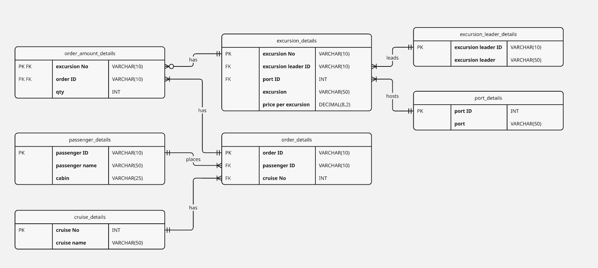

---

### **Task 3 - SQL Code & Print Screen Of SQL Output**

##### **SQL Code:**

CREATE DATABASE sunderland_cruise_ships;  

USE sunderland_cruise_ships;  

CREATE TABLE passenger_details (  
    passenger_id VARCHAR(10) NOT NULL PRIMARY KEY,  
    passenger_name VARCHAR(50) NOT NULL,  
    cabin VARCHAR(25) NOT NULL  
);  

CREATE TABLE cruise_details (  
    cruise_no INT NOT NULL PRIMARY KEY,  
    cruise_name VARCHAR(50) NOT NULL  
);  

CREATE TABLE port_details (  
    port_id INT NOT NULL PRIMARY KEY,  
    port VARCHAR(50) NOT NULL  
);  

CREATE TABLE excursion_leader_details (  
    excursion_leader_id VARCHAR(10) NOT NULL PRIMARY KEY,  
    excursion_leader VARCHAR(50) NOT NULL  
);  

CREATE TABLE excursion_details (  
    excursion_no VARCHAR(10) NOT NULL PRIMARY KEY,  
    excursion_leader_id VARCHAR(10) NOT NULL,  
    port_id INT NOT NULL,  
    excursion VARCHAR(50) NOT NULL,  
    price_per_excursion DECIMAL(8,2) NOT NULL,  
    FOREIGN KEY (excursion_leader_id) REFERENCES excursion_leader_details(excursion_leader_id),  
    FOREIGN KEY (port_id) REFERENCES port_details(port_id)  
);  

CREATE TABLE order_details (  
    order_id VARCHAR(10) NOT NULL PRIMARY KEY,  
    passenger_id VARCHAR(10) NOT NULL,  
    cruise_no INT NOT NULL,  
    FOREIGN KEY (passenger_id) REFERENCES passenger_details(passenger_id),  
    FOREIGN KEY (cruise_no) REFERENCES cruise_details(cruise_no)  
);  

CREATE TABLE order_amount_details (  
    order_id VARCHAR(10) NOT NULL,  
    excursion_no VARCHAR(10) NOT NULL,  
    qty INT NOT NULL,  
    PRIMARY KEY(order_id,excursion_no),  
    FOREIGN KEY (order_id) REFERENCES order_details(order_id),  
    FOREIGN KEY (excursion_no) REFERENCES excursion_details(excursion_no)  
);  

#(Perplexity, 2026)

<mark>INSERT INTO passenger_details (passenger_id, passenger_name, cabin) VALUES</mark>
<mark>('P001', 'Laila Allen', '2824'),</mark>
<mark>('P002', 'Jack Harris', '1409'),</mark>
<mark>('P003', 'Charlie Nelson', '5506'),</mark>
<mark>('P004', 'Poppy Turner', '5012'),</mark>
<mark>('P005', 'Muhammad Hall', '4657'),</mark>
<mark>('P006', 'Sophia Hall', '3286'),</mark>
<mark>('P007', 'Mason White', '2679'),</mark>
<mark>('P008', 'Sara Young', '9935'),</mark>
<mark>('P009', 'Omar Bell', '2424'),</mark>
<mark>('P010', 'Ali Jones', '7912'),</mark>
<mark>('P011', 'Violet Reed', '1520'),</mark>
<mark>('P012', 'Sophia Edwards', '1488'),</mark>
<mark>('P013', 'Yusuf Martin', '2535'),</mark>
<mark>('P014', 'Sophia Turner', '4582'),</mark>
<mark>('P015', 'Logan Young', '4811'),</mark>
<mark>('P016', 'Muhammad Murphy', '9279'),</mark>
<mark>('P017', 'Layla Harris', '1434'),</mark>
<mark>('P018', 'Fatima Scott', '4257'),</mark>
<mark>('P019', 'Laila Cox', '9928'),</mark>
<mark>('P020', 'George Harris', '7873'),</mark>
<mark>('P021', 'Harry Scott', '4611'),</mark>
<mark>('P022', 'Aiden Young', '8359'),</mark>
<mark>('P023', 'Noah White', '5557'),</mark>
<mark>('P024', 'Nora Bailey', '1106'),</mark>
<mark>('P025', 'Liam White', '3615'),</mark>
<mark>('P026', 'Ali Campbell', '7924'),</mark>
<mark>('P027', 'Aiden Cook', '6574'),</mark>
<mark>('P028', 'Nathan Taylor', '5552'),</mark>
<mark>('P029', 'Mia Wilson', '3547'),</mark>
<mark>('P030', 'Isabella Cooper', '4527'),</mark>
<mark>('P031', 'Layla Edwards', '6514'),</mark>
<mark>('P032', 'Mia Cooper', '2674'),</mark>
<mark>('P033', 'Leah Perez', '2519'),</mark>
<mark>('P034', 'Leah Carter', '7224'),</mark>
<mark>('P035', 'Lucas Harris', '2584'),</mark>
<mark>('P036', 'Alfie Parker', '6881'),</mark>
<mark>('P037', 'Ava Garcia', '6635'),</mark>
<mark>('P038', 'Tariq Brown', '5333'),</mark>
<mark>('P039', 'Jacob Taylor', '1711'),</mark>
<mark>('P040', 'Muhammad Anderson', '8527'),</mark>
<mark>('P041', 'Fatima Perez', '9785'),</mark>
<mark>('P042', 'Violet Jones', '3045'),</mark>
<mark>('P043', 'Logan Nelson', '7201'),</mark>
<mark>('P044', 'Violet Turner', '2291'),</mark>
<mark>('P045', 'Chloe Thompson', '5803'),</mark>
<mark>('P046', 'Layla Smith', '6925'),</mark>
<mark>('P047', 'Fatima Rivera', '4150'),</mark>
<mark>('P048', 'Jacob Bell', '2139'),</mark>
<mark>('P049', 'Zoe Richardson', '1750'),</mark>
<mark>('P050', 'Poppy Cox', '4733');</mark>
<mark>INSERT INTO cruise_details (cruise_no, cruise_name) VALUES</mark>
<mark>(1001, 'Adriatic Jewels A1'),</mark>
<mark>(1002, 'Caribbean Bliss B1'),</mark>
<mark>(1003, 'Fjords Explorer C1'),</mark>
<mark>(1004, 'Arctic Adventure D1'),</mark>
<mark>(1005, 'Pacific Odyssey E1'),</mark>
<mark>(1006, 'Mediterranean Dream F1'),</mark>
<mark>(1007, 'Northern Lights G1'),</mark>
<mark>(1008, 'Baltic Highlights H1'),</mark>
<mark>(1009, 'Black Sea Discovery I1'),</mark>
<mark>(1010, 'Iberian Gem J1'),</mark>
<mark>(1011, 'Black Sea Discovery K1'),</mark>
<mark>(1012, 'Arctic Adventure L1'),</mark>
<mark>(1013, 'Southern Cross M1'),</mark>
<mark>(1014, 'Canary Islands Escape N1'),</mark>
<mark>(1015, 'Mediterranean Dream O1'),</mark>
<mark>(1016, 'Southern Cross P1'),</mark>
<mark>(1017, 'Iberian Gem Q1'),</mark>
<mark>(1018, 'Fjords Explorer R1'),</mark>
<mark>(1019, 'Scandinavian Saga S1'),</mark>
<mark>(1020, 'Adriatic Jewels T1'),</mark>
<mark>(1021, 'Arctic Adventure U1'),</mark>
<mark>(1022, 'Scandinavian Saga V1'),</mark>
<mark>(1023, 'Adriatic Jewels W1'),</mark>
<mark>(1024, 'Southern Cross X1'),</mark>
<mark>(1025, 'Eastern Spice Y1'),</mark>
<mark>(1026, 'Atlantic Voyage Z1'),</mark>
<mark>(1027, 'Mediterranean Dream A2'),</mark>
<mark>(1028, 'Caribbean Bliss B2'),</mark>
<mark>(1029, 'Canary Islands Escape C2'),</mark>
<mark>(1030, 'Mediterranean Dream D2'),</mark>
<mark>(1031, 'Southern Cross E2'),</mark>
<mark>(1032, 'Canary Islands Escape F2'),</mark>
<mark>(1033, 'Iberian Gem G2'),</mark>
<mark>(1034, 'Southern Cross H2'),</mark>
<mark>(1035, 'Iberian Gem I2'),</mark>
<mark>(1036, 'Baltic Highlights J2'),</mark>
<mark>(1037, 'Eastern Spice K2'),</mark>
<mark>(1038, 'Caribbean Bliss L2'),</mark>
<mark>(1039, 'Northern Lights M2'),</mark>
<mark>(1040, 'Baltic Highlights N2'),</mark>
<mark>(1041, 'Fjords Explorer O2'),</mark>
<mark>(1042, 'Iberian Gem P2'),</mark>
<mark>(1043, 'Caribbean Bliss Q2'),</mark>
<mark>(1044, 'Iberian Gem R2'),</mark>
<mark>(1045, 'Scandinavian Saga S2'),</mark>
<mark>(1046, 'Canary Islands Escape T2'),</mark>
<mark>(1047, 'Arctic Adventure U2'),</mark>
<mark>(1048, 'Atlantic Voyage V2'),</mark>
<mark>(1049, 'Baltic Highlights W2'),</mark>
<mark>(1050, 'Atlantic Voyage X2');</mark>
<mark>INSERT INTO port_details (port_id, port) VALUES</mark>
<mark>(1, 'Copenhagen'),</mark>
<mark>(2, 'Oslo'),</mark>
<mark>(3, 'St Petersburg'),</mark>
<mark>(4, 'Bergen'),</mark>
<mark>(5, 'Holden'),</mark>
<mark>(6, 'Amsterdam'),</mark>
<mark>(7, 'Hamburg'),</mark>
<mark>(8, 'Lisbon'),</mark>
<mark>(9, 'Barcelona'),</mark>
<mark>(10, 'Venice'),</mark>
<mark>(11, 'Athens'),</mark>
<mark>(12, 'Istanbul'),</mark>
<mark>(13, 'Dubrovnik'),</mark>
<mark>(14, 'Helsinki'),</mark>
<mark>(15, 'Stockholm'),</mark>
<mark>(16, 'Tallinn'),</mark>
<mark>(17, 'Riga'),</mark>
<mark>(18, 'Gdansk'),</mark>
<mark>(19, 'Dublin'),</mark>
<mark>(20, 'Reykjavik'),</mark>
<mark>(21, 'Tromso'),</mark>
<mark>(22, 'Stavanger'),</mark>
<mark>(23, 'Malaga'),</mark>
<mark>(24, 'Valencia'),</mark>
<mark>(25, 'Marseille'),</mark>
<mark>(26, 'Genoa'),</mark>
<mark>(27, 'Naples'),</mark>
<mark>(28, 'Palermo'),</mark>
<mark>(29, 'Split'),</mark>
<mark>(30, 'Kotor'),</mark>
<mark>(31, 'Santorini'),</mark>
<mark>(32, 'Rhodes'),</mark>
<mark>(33, 'Heraklion'),</mark>
<mark>(34, 'Valletta'),</mark>
<mark>(35, 'Tunis'),</mark>
<mark>(36, 'Casablanca'),</mark>
<mark>(37, 'Tangier'),</mark>
<mark>(38, 'Cadiz'),</mark>
<mark>(39, 'Vigo'),</mark>
<mark>(40, 'Porto'),</mark>
<mark>(41, 'Bordeaux'),</mark>
<mark>(42, 'Le Havre'),</mark>
<mark>(43, 'Calais'),</mark>
<mark>(44, 'Dover'),</mark>
<mark>(45, 'Southampton'),</mark>
<mark>(46, 'Plymouth'),</mark>
<mark>(47, 'Cork'),</mark>
<mark>(48, 'Galway'),</mark>
<mark>(49, 'Belfast'),</mark>
<mark>(50, 'Limerick');</mark>
<mark>INSERT INTO excursion_leader_details (excursion_leader_id, excursion_leader) VALUES</mark>
<mark>('L001', 'Kevin Garcia'),</mark>
<mark>('L002', 'Laura Rivera'),</mark>
<mark>('L003', 'Donna Jones'),</mark>
<mark>('L004', 'Tony Edwards'),</mark>
<mark>('L005', 'Sandra Wilson'),</mark>
<mark>('L006', 'Paul Morgan'),</mark>
<mark>('L007', 'Alex Collins'),</mark>
<mark>('L008', 'Chris Thompson'),</mark>
<mark>('L009', 'Wendy Morris'),</mark>
<mark>('L010', 'Fiona White'),</mark>
<mark>('L011', 'Gary Richardson'),</mark>
<mark>('L012', 'Brian Murphy'),</mark>
<mark>('L013', 'Tom Bailey'),</mark>
<mark>('L014', 'Lisa Carter'),</mark>
<mark>('L015', 'Simon Cook'),</mark>
<mark>('L016', 'Amy Roberts'),</mark>
<mark>('L017', 'Wendy Roberts'),</mark>
<mark>('L018', 'Anna Martin'),</mark>
<mark>('L019', 'Dan Jones'),</mark>
<mark>('L020', 'Nina Johnson'),</mark>
<mark>('L021', 'Diane Collins'),</mark>
<mark>('L022', 'Dan Sanchez'),</mark>
<mark>('L023', 'Dan Smith'),</mark>
<mark>('L024', 'David Bailey'),</mark>
<mark>('L025', 'Peter Brown'),</mark>
<mark>('L026', 'Dan Jones'),</mark>
<mark>('L027', 'Mike Green'),</mark>
<mark>('L028', 'David Parker'),</mark>
<mark>('L029', 'Claire Young'),</mark>
<mark>('L030', 'Simon Campbell'),</mark>
<mark>('L031', 'Lucy Edwards'),</mark>
<mark>('L032', 'Paul Rivera'),</mark>
<mark>('L033', 'Kevin Stewart'),</mark>
<mark>('L034', 'Alex Martin'),</mark>
<mark>('L035', 'Alex Mitchell'),</mark>
<mark>('L036', 'Tom Miller'),</mark>
<mark>('L037', 'James Morgan'),</mark>
<mark>('L038', 'Fiona Baker'),</mark>
<mark>('L039', 'Fiona Mitchell'),</mark>
<mark>('L040', 'Tina Rivera'),</mark>
<mark>('L041', 'Emma Bell'),</mark>
<mark>('L042', 'Janet Cook'),</mark>
<mark>('L043', 'James Brown'),</mark>
<mark>('L044', 'Zara Rivera'),</mark>
<mark>('L045', 'Nina Miller'),</mark>
<mark>('L046', 'Claire Jackson'),</mark>
<mark>('L047', 'Tom Edwards'),</mark>
<mark>('L048', 'Sam Wilson'),</mark>
<mark>('L049', 'Fiona Thomas'),</mark>
<mark>('L050', 'Helen Turner');</mark>
<mark>INSERT INTO excursion_details (excursion_no, excursion_leader_id, port_id, excursion, price_per_excursion) VALUES</mark>
<mark>('EX001', 'L004', 38, 'City Walking Tour', 300),</mark>
<mark>('EX002', 'L048', 35, 'Castle Visit', 350),</mark>
<mark>('EX003', 'L004', 48, 'Wine Tasting', 30),</mark>
<mark>('EX004', 'L021', 4, 'Whale Watching', 100),</mark>
<mark>('EX005', 'L004', 38, 'Kayaking Adventure', 250),</mark>
<mark>('EX006', 'L031', 33, 'Museum Trail', 300),</mark>
<mark>('EX007', 'L034', 11, 'Cooking Class', 300),</mark>
<mark>('EX008', 'L004', 33, 'Bike Ride', 120),</mark>
<mark>('EX009', 'L006', 12, 'Boat Cruise', 30),</mark>
<mark>('EX010', 'L005', 39, 'Hiking Trek', 25),</mark>
<mark>('EX011', 'L005', 44, 'Art Gallery Tour', 175),</mark>
<mark>('EX012', 'L016', 26, 'Food Market Visit', 120),</mark>
<mark>('EX013', 'L008', 37, 'Volcano Hike', 300),</mark>
<mark>('EX014', 'L016', 38, 'Snorkelling Trip', 25),</mark>
<mark>('EX015', 'L039', 3, 'Dolphin Watch', 30),</mark>
<mark>('EX016', 'L040', 6, 'Historic Quarter Tour', 350),</mark>
<mark>('EX017', 'L027', 43, 'Lighthouse Visit', 250),</mark>
<mark>('EX018', 'L038', 37, 'Beach Excursion', 300),</mark>
<mark>('EX019', 'L034', 21, 'Viking Museum', 50),</mark>
<mark>('EX020', 'L017', 14, 'Opera House Tour', 40),</mark>
<mark>('EX021', 'L043', 46, 'Cliff Walk', 80),</mark>
<mark>('EX022', 'L021', 16, 'Fishing Trip', 100),</mark>
<mark>('EX023', 'L017', 26, 'Cultural Dance Show', 100),</mark>
<mark>('EX024', 'L009', 43, 'Falconry Experience', 50),</mark>
<mark>('EX025', 'L042', 20, 'Hot Spring Dip', 300),</mark>
<mark>('EX026', 'L030', 21, 'Waterfall Hike', 80),</mark>
<mark>('EX027', 'L049', 5, 'Glacier Walk', 350),</mark>
<mark>('EX028', 'L001', 30, 'Northern Lights Tour', 25),</mark>
<mark>('EX029', 'L040', 37, 'Folk Village Visit', 40),</mark>
<mark>('EX030', 'L007', 5, 'Spice Market Tour', 80),</mark>
<mark>('EX031', 'L035', 14, 'Night City Tour', 25),</mark>
<mark>('EX032', 'L033', 17, 'Sunset Cruise', 80),</mark>
<mark>('EX033', 'L009', 23, 'Cave Exploration', 60),</mark>
<mark>('EX034', 'L005', 16, 'Puffin Watching', 350),</mark>
<mark>('EX035', 'L024', 19, 'Reindeer Safari', 250),</mark>
<mark>('EX036', 'L011', 29, 'Brewery Tour', 250),</mark>
<mark>('EX037', 'L035', 46, 'Distillery Visit', 100),</mark>
<mark>('EX038', 'L020', 40, 'Street Art Walk', 60),</mark>
<mark>('EX039', 'L042', 34, 'Panorama Cable Car', 80),</mark>
<mark>('EX040', 'L001', 43, 'Salt Flat Tour', 200),</mark>
<mark>('EX041', 'L036', 20, 'Jazz Quarter Walk', 200),</mark>
<mark>('EX042', 'L043', 7, 'Cathedral Tour', 250),</mark>
<mark>('EX043', 'L009', 17, 'Royal Palace Visit', 120),</mark>
<mark>('EX044', 'L008', 7, 'Botanical Garden', 175),</mark>
<mark>('EX045', 'L048', 36, 'Harbour Ferry', 200),</mark>
<mark>('EX046', 'L010', 18, 'Windmill Tour', 100),</mark>
<mark>('EX047', 'L019', 39, 'Tulip Field Visit', 40),</mark>
<mark>('EX048', 'L014', 46, 'Cheese Farm Tour', 50),</mark>
<mark>('EX049', 'L022', 14, 'Christmas Market', 60),</mark>
<mark>('EX050', 'L044', 41, 'Birdwatching Walk', 50);</mark>
<mark>INSERT INTO order_details (order_id, passenger_id, cruise_no) VALUES</mark>
<mark>('ORD001', 'P017', 1033),</mark>
<mark>('ORD002', 'P032', 1017),</mark>
<mark>('ORD003', 'P004', 1006),</mark>
<mark>('ORD004', 'P041', 1028),</mark>
<mark>('ORD005', 'P018', 1003),</mark>
<mark>('ORD006', 'P001', 1022),</mark>
<mark>('ORD007', 'P050', 1009),</mark>
<mark>('ORD008', 'P041', 1017),</mark>
<mark>('ORD009', 'P011', 1048),</mark>
<mark>('ORD010', 'P029', 1036),</mark>
<mark>('ORD011', 'P046', 1028),</mark>
<mark>('ORD012', 'P036', 1001),</mark>
<mark>('ORD013', 'P008', 1005),</mark>
<mark>('ORD014', 'P045', 1010),</mark>
<mark>('ORD015', 'P035', 1003),</mark>
<mark>('ORD016', 'P024', 1038),</mark>
<mark>('ORD017', 'P036', 1010),</mark>
<mark>('ORD018', 'P028', 1009),</mark>
<mark>('ORD019', 'P003', 1020),</mark>
<mark>('ORD020', 'P024', 1003),</mark>
<mark>('ORD021', 'P023', 1014),</mark>
<mark>('ORD022', 'P044', 1016),</mark>
<mark>('ORD023', 'P043', 1007),</mark>
<mark>('ORD024', 'P023', 1050),</mark>
<mark>('ORD025', 'P036', 1027),</mark>
<mark>('ORD026', 'P040', 1048),</mark>
<mark>('ORD027', 'P010', 1016),</mark>
<mark>('ORD028', 'P011', 1012),</mark>
<mark>('ORD029', 'P027', 1002),</mark>
<mark>('ORD030', 'P012', 1048),</mark>
<mark>('ORD031', 'P022', 1027),</mark>
<mark>('ORD032', 'P043', 1048),</mark>
<mark>('ORD033', 'P016', 1018),</mark>
<mark>('ORD034', 'P011', 1045),</mark>
<mark>('ORD035', 'P007', 1025),</mark>
<mark>('ORD036', 'P003', 1031),</mark>
<mark>('ORD037', 'P015', 1013),</mark>
<mark>('ORD038', 'P030', 1023),</mark>
<mark>('ORD039', 'P020', 1015),</mark>
<mark>('ORD040', 'P015', 1002),</mark>
<mark>('ORD041', 'P043', 1013),</mark>
<mark>('ORD042', 'P026', 1022),</mark>
<mark>('ORD043', 'P018', 1005),</mark>
<mark>('ORD044', 'P050', 1018),</mark>
<mark>('ORD045', 'P023', 1042),</mark>
<mark>('ORD046', 'P033', 1026),</mark>
<mark>('ORD047', 'P044', 1035),</mark>
<mark>('ORD048', 'P022', 1002),</mark>
<mark>('ORD049', 'P008', 1017),</mark>
<mark>('ORD050', 'P012', 1038);</mark>
<mark>INSERT INTO order_amount_details (order_id, excursion_no, qty) VALUES</mark>
<mark>('ORD017', 'EX003', 2),</mark>
<mark>('ORD039', 'EX028', 6),</mark>
<mark>('ORD047', 'EX021', 7),</mark>
<mark>('ORD039', 'EX033', 2),</mark>
<mark>('ORD025', 'EX037', 4),</mark>
<mark>('ORD046', 'EX028', 1),</mark>
<mark>('ORD034', 'EX035', 4),</mark>
<mark>('ORD024', 'EX028', 2),</mark>
<mark>('ORD043', 'EX022', 10),</mark>
<mark>('ORD021', 'EX043', 2),</mark>
<mark>('ORD047', 'EX020', 9),</mark>
<mark>('ORD020', 'EX043', 7),</mark>
<mark>('ORD021', 'EX026', 5),</mark>
<mark>('ORD036', 'EX009', 4),</mark>
<mark>('ORD027', 'EX043', 7),</mark>
<mark>('ORD044', 'EX048', 3),</mark>
<mark>('ORD040', 'EX037', 5),</mark>
<mark>('ORD026', 'EX036', 1),</mark>
<mark>('ORD020', 'EX019', 4),</mark>
<mark>('ORD028', 'EX038', 10),</mark>
<mark>('ORD042', 'EX021', 8),</mark>
<mark>('ORD029', 'EX029', 4),</mark>
<mark>('ORD033', 'EX031', 3),</mark>
<mark>('ORD043', 'EX006', 5),</mark>
<mark>('ORD033', 'EX043', 10),</mark>
<mark>('ORD022', 'EX006', 4),</mark>
<mark>('ORD044', 'EX020', 4),</mark>
<mark>('ORD013', 'EX010', 1),</mark>
<mark>('ORD003', 'EX016', 8),</mark>
<mark>('ORD040', 'EX050', 2),</mark>
<mark>('ORD030', 'EX027', 10),</mark>
<mark>('ORD013', 'EX046', 7),</mark>
<mark>('ORD032', 'EX026', 4),</mark>
<mark>('ORD010', 'EX042', 1),</mark>
<mark>('ORD049', 'EX050', 2),</mark>
<mark>('ORD050', 'EX028', 4),</mark>
<mark>('ORD012', 'EX045', 9),</mark>
<mark>('ORD030', 'EX004', 9),</mark>
<mark>('ORD016', 'EX008', 8),</mark>
<mark>('ORD009', 'EX030', 9),</mark>
<mark>('ORD036', 'EX039', 6),</mark>
<mark>('ORD049', 'EX029', 10),</mark>
<mark>('ORD047', 'EX033', 7),</mark>
<mark>('ORD036', 'EX029', 3),</mark>
<mark>('ORD048', 'EX031', 8),</mark>
<mark>('ORD017', 'EX049', 4),</mark>
<mark>('ORD041', 'EX018', 9),</mark>
<mark>('ORD032', 'EX041', 4),</mark>
<mark>('ORD018', 'EX029', 2),</mark>
<mark>('ORD046', 'EX019', 4);</mark>

##### **SQL Input:**

**passenger_details Table:**

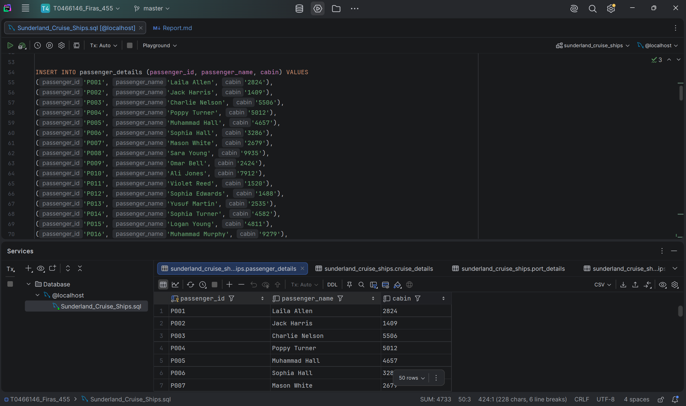

**cruise_details Table:**

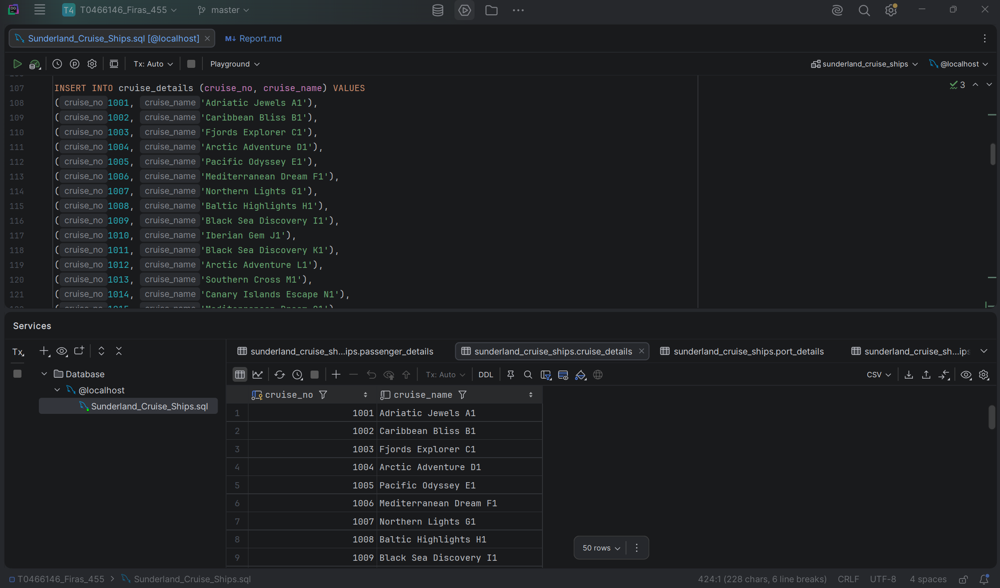

**port_details Table:**

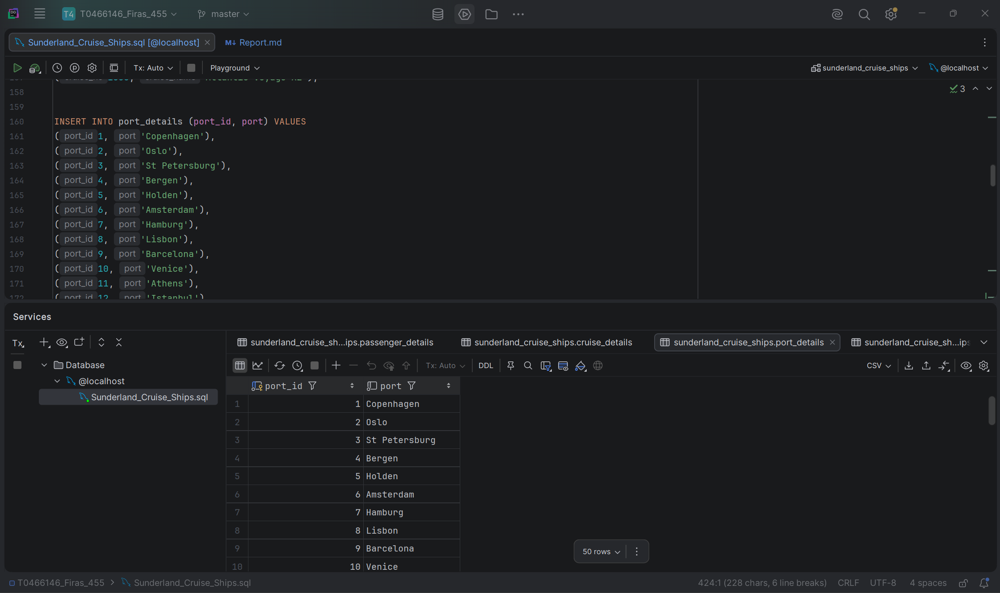

**excursion_leader_details Table:**

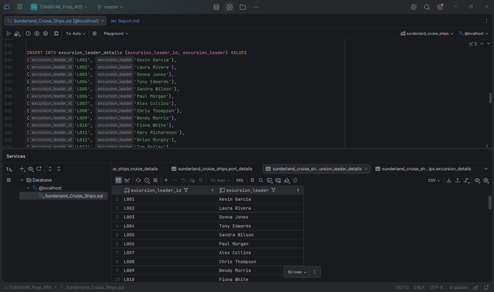

**excursion_details Table:**

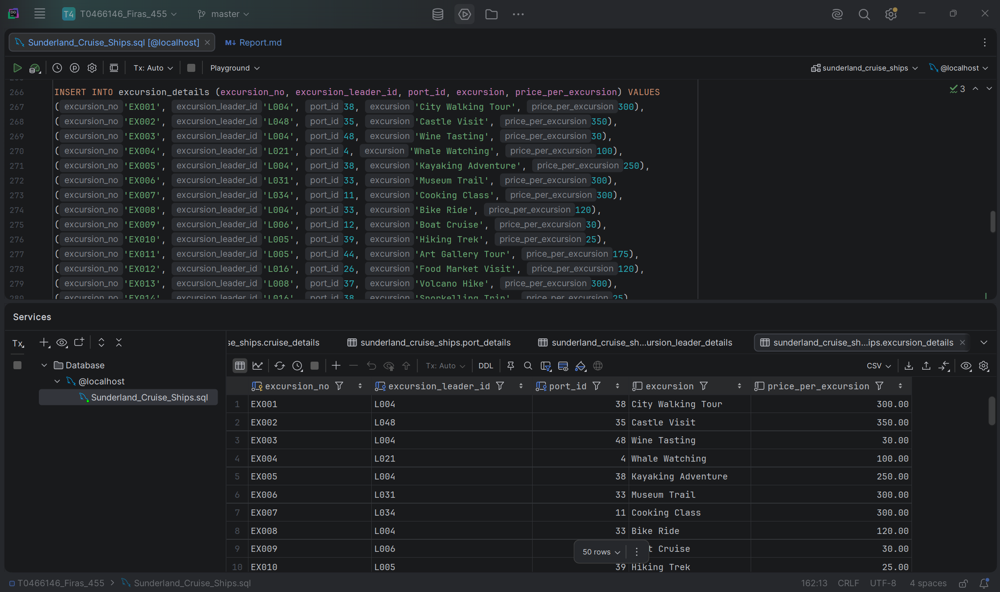

**order_details Table:**

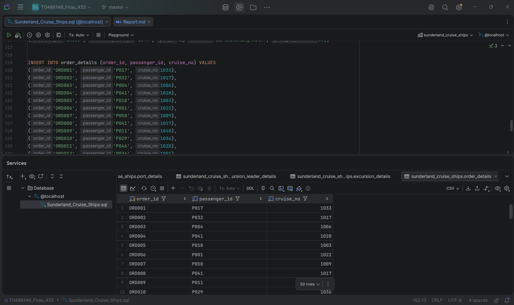

**order_amount_details Table:**

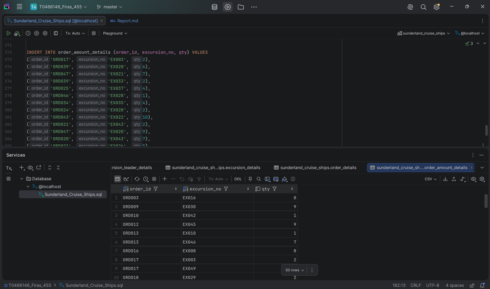

---

### **Task 4 - SQL Code & Print Screen Of SQL Output**

**i)** Update the cost for excursions where the port is ‘Copenhagen’  so they are increased by a percentage equivalent to the 4th and 5th characters in your T-Number.  For example, if your T-Number is T003456 increase the excursion prices by 34%.  

UPDATE excursion_details  
SET price_per_excursion = price_per_excursion * 1.61  
WHERE port_id = (SELECT port_id FROM port_details WHERE port = 'Copenhagen');  

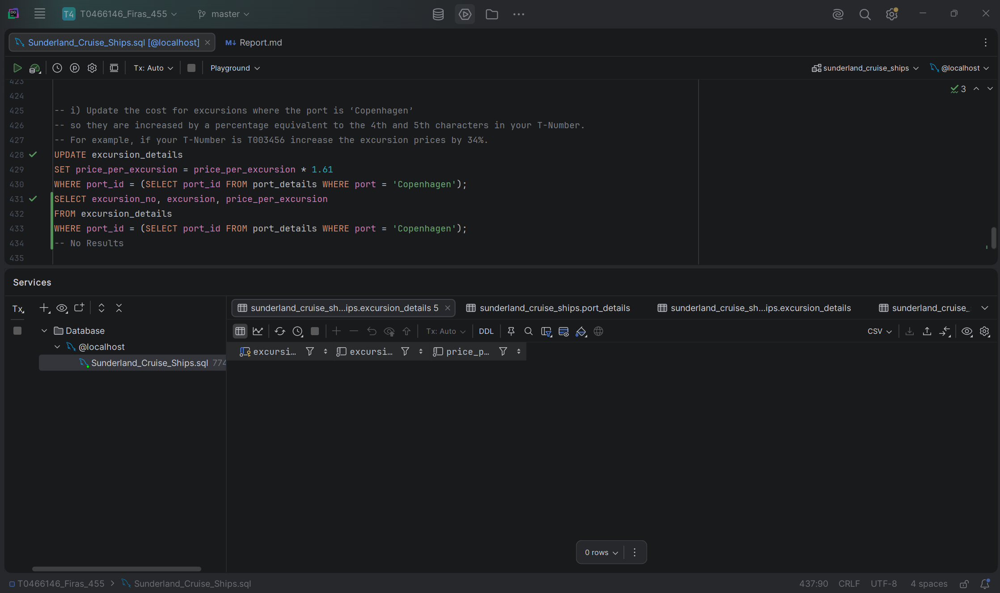

**ii)** Create a list that shows the orderID, passenger number, and passenger name and passenger cabin. The headings for the columns should be “Order ID”, “Passenger ID”, “Name of Passenger” and “Cabin”.  

SELECT o.order_id AS "Order ID", p.passenger_id AS "Passenger ID", p.passenger_name AS "Name of Passenger", p.cabin AS "Cabin"  
FROM order_details AS o  
JOIN passenger_details AS p ON o.passenger_id = p.passenger_id;  

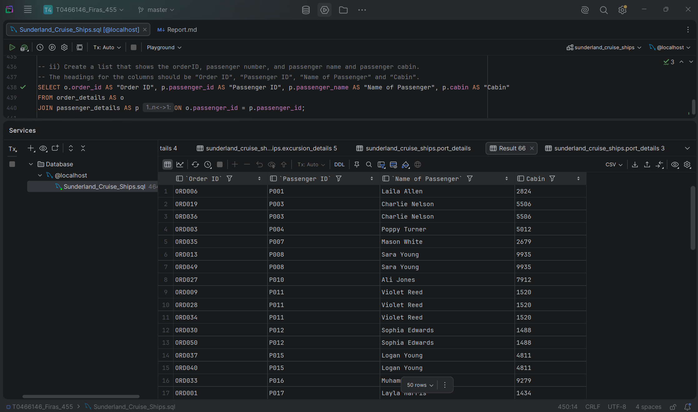

**iii)** Display the passenger details for all passengers going on an excursion in St Petersburg or Oslo.  

SELECT DISTINCT p.passenger_id, p.passenger_name, p.cabin  
FROM passenger_details AS p  
JOIN order_details AS o ON p.passenger_id = o.passenger_id  
JOIN order_amount_details AS oa ON o.order_id = oa.order_id  
JOIN excursion_details AS e ON oa.excursion_no = e.excursion_no  
JOIN port_details AS pt ON e.port_id = pt.port_id  
WHERE pt.port IN ('St Petersburg', 'Oslo');  

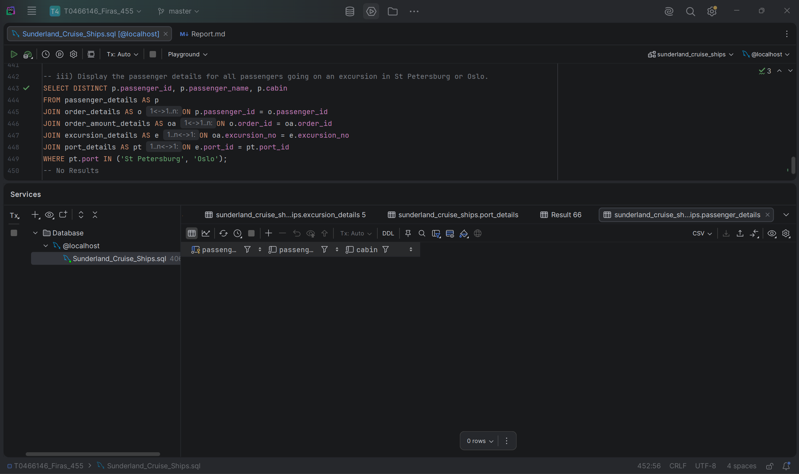

**iv)** Display the order number, passenger name and who has bought more than 4 tickets on the C001 excursion.  

SELECT o.order_id, p.passenger_name, oa.qty, oa.excursion_no  
FROM passenger_details AS p  
JOIN order_details AS o ON p.passenger_id = o.passenger_id  
JOIN order_amount_details AS oa ON o.order_id = oa.order_id  
WHERE oa.excursion_no = 'C001' AND oa.qty > 4;  

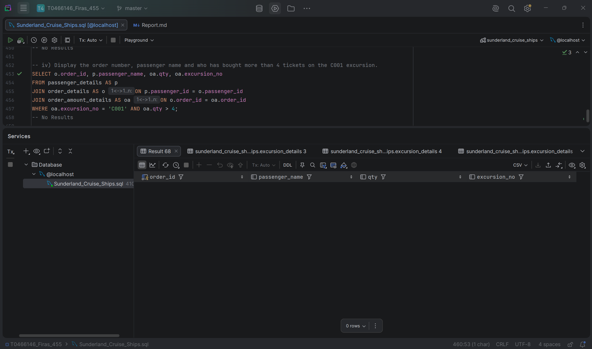

**v)** If the last character in the T-Number is equal to 6, produce the SQL to determine how many excursions are booked by cruise name.  

SELECT c.cruise_name, COUNT(oa.excursion_no) AS total_excursions_booked  
FROM cruise_details AS c  
LEFT JOIN order_details AS o ON c.cruise_no = o.cruise_no  
JOIN order_amount_details AS oa ON o.order_id = oa.order_id  
GROUP BY c.cruise_name;  

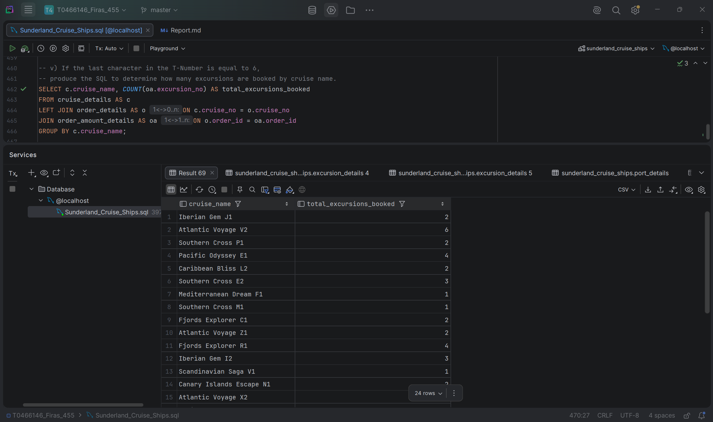

**vi)** Display the passenger details, excursion details for passengers whose name starts with the first two letters of your first name but do not include the last 2 letters of your last name.

SELECT DISTINCT p.passenger_name, p.passenger_id, p.cabin, e.excursion_no, e.excursion_leader_id, e.port_id, e.excursion, e.price_per_excursion  
FROM passenger_details AS p  
JOIN order_details AS o ON p.passenger_id = o.passenger_id  
JOIN order_amount_details AS oa ON o.order_id = oa.order_id  
JOIN excursion_details AS e ON oa.excursion_no = e.excursion_no  
WHERE p.passenger_name LIKE 'Fi%' AND p.passenger_name NOT LIKE 'ti%';  

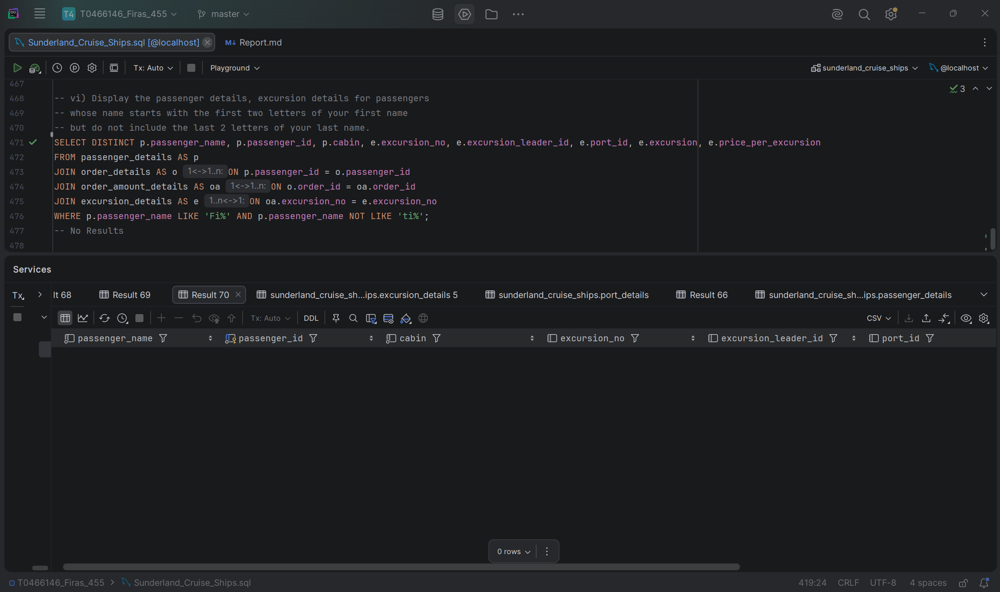

---

### **References:**

Perplexity(2026)*OpenA*I(June 20 version)[Large language model]
Prompt: "I am working on a database system implementation model as follows:
port_details (port ID PK, port)
excursion_leader_details (excursion leader ID PK, excursion leader)
cruise_details (cruise No PK, cruise name)
passenger_details (passenger ID PK, passenger name, cabin)
excursion_details (excursion No PK, excursion leader ID FK, port ID FK, excursion, price per excursion)
order_details (order ID PK, passenger ID FK, cruise No FK)
order_amount_details (excursion No PK/FK, order ID PK/FK, qty)
Please create a data set for me of 50 records for each table, make sure that some tables are related using FK in order to not mess the data up."

---
